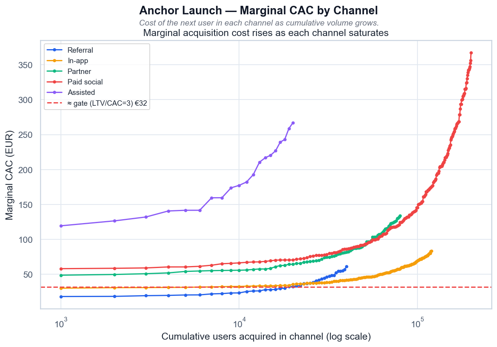

# Volta — Anchor Launch CAC at Scale

[](https://github.com/NikitaBoyarkin/case-anchor-cac/actions/workflows/ci.yml)

[](LICENSE)

LTV/CAC ≥3 holds only to ~70K users; at SOM it falls to 1.76× and a 17-month payback. The constraint is cheap-channel capacity, not budget.

## Key results

- LTV/CAC ≥3 gate holds to ~70K
- At SOM 1.76× and 17.0-month payback
- Referral €18→61, capacity 40K

## Situation

The 25–34 anchor is the growth point, but does the launch scale economically when taken to SOM.

## Task

I owned the question of whether the anchor segment stays economically viable once the launch is scaled to the serviceable market.

## Actions

- Marginal-CAC curves by channel (saturation).
- Cheap-first greedy allocation, blended LTV/CAC and payback vs scale.
- Break-even scale, channel-mix and capacity analysis.

## Result

- The LTV/CAC ≥3 gate holds only to ≈ **70K** users (31% of SOM).
- At SOM (225K): **LTV/CAC 1.76×**, **17.0-month** payback — both gates fail; the marginal SOM user costs **€80**.
- The constraint is cheap-channel capacity: referral €18→61 (capacity 40K), paid social €58→368 (200K).

## Recommendations

- Don't plan the anchor to SOM on a paid budget (hold).
- Raise referral and in-app conversion (capacity + CAC), cap paid at scale.
- Replan SOM around what cheap channels can carry.

## Charts



> # Anchor Launch — Marginal CAC by Channel
>
> 
>
> *Маржинальный CAC по каналам: цена следующего юзера растёт по мере насыщения канала.*
>
> ## Выводы
>
> - Реферал дешёвый (€18–61), но ёмкость мала (~40K) — исчерпывается первым.
> - Paid social даёт объём (200K), но маржинальный CAC растёт до €368 — в 2 раза выше гейта.
> - Assisted — самый дорогой вход (€120–267) и малая ёмкость (20K).
> - Красная линия — порог LTV/CAC=3: всё, что выше, разрушает launch-P&L.
>
> ---
> <sub>Источник: `scripts/volta_anchor_cac.py` · данные: `data/volta_anchor_cac.csv`</sub>


> # Anchor Launch — Blended LTV/CAC vs Scale
>
> 
>
> *Blended LTV/CAC по мере масштабирования запуска; гейт ≥3 ломается на дешёвых каналах.*
>
> ## Выводы
>
> - Гейт LTV/CAC ≥ 3 держится только до ≈ 70K юзеров — пока не исчерпаны referral и дешёвый in_app.
> - На SOM (225K) blended LTV/CAC падает до 1,76 — launch-P&L ломается.
> - Причина — маржинальный CAC: последний юзер SOM приходит из partner/paid по €100–368.
> - Рычаг — не бюджет, а ёмкость дешёвых каналов (реферал, in-app) и их конверсия.
>
> ---
> <sub>Источник: `scripts/volta_anchor_cac.py` · данные: `data/volta_anchor_cac.csv`</sub>

## Dataset

The dataset is fully synthetic, generated by seeded, reproducible script(s) (`scripts/generate_anchor_cac_data.py`). No real customer data is used. Running `make data` regenerates the CSV(s) in `data/` with the same random seed, so every number below is reproducible.

## Quick start

```bash
uv sync --all-groups
make data
make run
```

## Project structure

```text
case-anchor-cac/
├── README.md
├── LICENSE
├── .gitignore
├── .python-version
├── pyproject.toml
├── Makefile
├── .github/workflows/ci.yml
├── scripts/
│   ├── generate_anchor_cac_data.py
│   └── volta_anchor_cac.py
├── utils/
│   ├── __init__.py
│   ├── common.py
│   └── viz_helpers.py
├── data/
│   └── volta_anchor_cac.csv
├── outputs/
│   ├── anchor_cac_marginal_curves.png
│   ├── anchor_ltv_cac_vs_scale.png
└── tests/
    └── test_anchor_cac.py
```

## Stack

- Python
- pandas / NumPy
- SciPy / Statsmodels
- scikit-learn
- Matplotlib / Seaborn
- uv + ruff

## Links

- [Full case study on the portfolio site](https://nikitaboyarkin.github.io/en/projects/volta/anchor-cac/)
- [Parent project — volta-banking](https://github.com/NikitaBoyarkin/volta-banking)
